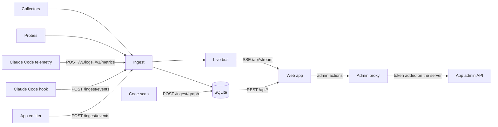

# How Mycelium Monitor works

Mycelium Monitor watches several apps at once. For each app, and for all of them together, it shows whether the app is up, what it costs, how much it is used and which APIs it calls. The owner can change an app's admin settings from one place. A live map shows every file, data store, web address and outside API, and a dot runs along a line each time Claude Code or the app reads or writes something.

Reroute is the first app. Nothing is special to Reroute: any app joins with an ingest key and, if it wants, an admin address.

Written with Claude Code; a person needs to review it.

## Big rules

- **Same look and feel as every Mycelium site.** See `DESIGN.md` and `docs/design/`.
- **Small, boring back end.** Flask, one SQLite file (WAL), and server-sent events. One process is enough.
- **Add a feature as one collector plus one panel** (see the end of this file).
- **The site is private; the code is public.**
- **Never store contents or secrets.** Events hold paths, sizes, times and counts. Never file contents, request bodies, tokens, keys or personal data.

## Words

| Word | Meaning |
|---|---|
| App | A watched app: slug, name, base URL, repo folder, ingest key (stored hashed), maybe an admin URL and admin token (token only in the server's environment). |
| Source | Who sent an event: `app`, `claude` (Claude Code), `probe` (Mycelium's own checks), `collector` (data Mycelium pulls). |
| Node | A thing on the map: `file`, `folder`, `store`, `endpoint`, `external`, `config`, `actor`. Its id is `kind:path`, like `file:apps/plan-b-mvp/rides.py`. |
| Edge | A line between two nodes. Static edges come from scanning the code. Runtime edges come from events. |

## One event

```json
{"ts": "2026-10-30T07:39:34.120Z", "app": "reroute", "source": "app", "kind": "write", "actor": "actor:app",
 "node": "file:apps/plan-b-mvp/rides.py", "target": "store:data/rides.sqlite3", "status": "ok",
 "duration_ms": 3.2, "bytes": 412, "usd": 0, "meta": {"op": "report"}}
```

`kind` is `request`, `read`, `write`, `external`, `probe`, `cost`, `admin` or `log`. Extra fields go in `meta` (2 KB at most). An event more than 10 minutes in the future is refused. The server adds its own receive time.

## How data gets in



- **Emitter** (`emitters/python/mycelium_emitter.py`): one file, standard library only. It does nothing unless `MYCELIUM_URL` and `MYCELIUM_KEY` are set. It queues events (drops the oldest past 10,000) and sends them every 2s or every 200. If Mycelium is down it drops the batch; it never slows the app. Tools: `init_telemetry(app)` (one `request` per HTTP request, using the route rule, not the URL), `emit(...)`, `timed(kind, node, target)` for outside calls, `watch_sqlite(conn, node, store)` (read or write from the first SQL word; SQL text is never sent). Reroute keeps an identical copy in `apps/plan-b-mvp/`.
- **Claude Code hook** (`hooks/claude/`): sends the tool name, the path inside the repo and the time taken, for Read, Glob and Grep (`read`) and Edit, Write and NotebookEdit (`write`). Paths outside a registered repo are dropped on your computer.
- **Claude Code telemetry** (`server/api/otlp.py`): `POST /v1/logs` and `/v1/metrics`, JSON only (protobuf gets 415), using the app's ingest key. `api_request` and `api_error` logs become `external` events to `external:anthropic-api` with cost, time, model and token counts. Metrics keep only session, lines-of-code, commit and pull-request counts (cost metrics would count twice). Only listed attributes are kept, so emails, user ids, prompts and error text are never stored.
- **Probes** (`server/collectors/probes.py`): health every 60s, readiness every 5 min. Uptime comes from these.
- **Collectors** (`server/collectors/`): pull data an app already offers, like Reroute's `/admin/usage` every 5 min, with the admin token from `MYCELIUM_ADMIN_TOKEN_<SLUG>`. A scheduler thread runs them; `MYCELIUM_SCHEDULER=0` turns it off.
- **Code scan** (`emitters/python/mycelium_scan.py`): reads a repo (Python `ast` and patterns for JS, HTML, CSS; no AI) and sends only names and links: imports, tests, routes to handler files, front-end calls to routes, code to data stores and outside hosts, config variable names (never values), and folders. Each push replaces that app's static links. Limits: links are per file, not per function; routes made at run time are missed.

## Storage

One SQLite file (`MYCELIUM_DB`, default `server/data/mycelium.sqlite3`). Tables: `apps`, `events` (raw, kept 30 days), `rollups` (per app per hour and day; kept forever), `probes`, `nodes`, `edges`, `audit`, `settings`. An hourly job rolls up and prunes. Ingest takes up to 500 events per batch and 6,000 per key per minute; the app always comes from the key.

## Live stream

`GET /api/stream?app=<slug>` sends each new event to the browser, at most 50 a second per browser. Extra events are counted and reported as a `dropped` event.

## Reading data

`GET /api/apps`, `/api/summary` (with the previous 24 hours), `/api/activity`, `/api/uptime`, `/api/costs`, `/api/usage`, `/api/events` (filters `kind`, `source`, `paid`; paging with `before`), `/api/graph`. Each takes `?app=<slug>` or covers all apps. Key hashes and admin tokens are never returned. Daily API cost is the larger of live cost events and the pulled usage figure, not both added. 24-hour figures come from raw events (shortcut; switch to rollups if volume grows).

## The web app

- Routes are `/<app or all>/<panel>`. Panels: Overview, Live map, Status and uptime, Costs, Usage, API details, Transactions, Event log, plus Access and Settings as header tools. All are listed in `web/src/panels/index.js`; a panel hides when the app lacks something it `requires`.
- Ctrl+K opens a palette to jump to any app or panel.
- The Overview is customisable (Customise: drag, move, resize, hide and add cards; `customise.jsx` from the design kit). The layout is kept in this browser only (`localStorage` key `mycelium-overview-layout`), never on the server.
- **Live map** (`web/src/panels/Map.jsx`): a 3D map, `3d-force-graph` 1.80.1 on three.js 0.186.1, loaded only when the map opens (about 230 KB gzipped). Nodes are shaded spheres coloured by kind and sized by their links. Drag to turn, scroll to zoom, right-drag to pan. Clicking a node flies the camera round to its cluster (1.2s) and lights it up; empty space or Escape flies back. Each live event sends a dot along its line (read teal, write accent, outside orange, error red) that ends in a ring; lines used in the last 60s carry faint slow dots. Fast: shared shapes and materials, pulses as instanced meshes, it only draws while something moves, pauses off screen, and frees graphics memory when you leave. `vite.config.js` swaps three's WebGPU build for a tiny stub (`panels/no-webgpu.js`) the map never uses, which saves about 170 KB gzipped. Keyboard: Up and Down through nodes, Left and Right through neighbours, Enter for details, Escape to clear. There is a Graph/Table switch, a Find box and a spoken summary every 10s. Dragging no longer pins nodes. The Overview's small preview stays 2D (`force-graph` 1.52.0), so the home page stays light. Not built yet: replaying the last hour, filters by source.
- **Installable** (`web/public/`): a manifest, icons drawn from the `Logo` (redraw the PNGs if the logo changes) and `sw.js`, which caches only the app shell. API data and the stream never touch it. Offline, the app opens and says the server can't be reached. Installing needs HTTPS or localhost.

## Signing in and access

- **Owner sign-in** (`server/auth.py`): every `/api/` route needs the owner; `/ingest` and `/v1` use app keys. Ways in: Tailscale identity (`MYCELIUM_TRUST_TAILSCALE=1`, login listed in `MYCELIUM_OWNER`; only safe on 127.0.0.1 behind `tailscale serve`); a password (`MYCELIUM_PASSWORD`, a 12-hour cookie; set `MYCELIUM_SECRET_KEY` so sign-ins survive restarts and `MYCELIUM_SECURE_COOKIE=1` on HTTPS); or, with neither set, this computer only. Ten wrong passwords per 15 min per address, then a wait.
- **Cross-site safety:** every changing `/api/` request must have an `Origin` that matches the host. Strict CSP and SameSite cookies.
- **Admin proxy** (`server/api/admin.py`): `GET`/`POST /api/admin/<app>/settings` and `/moderation`, `POST /api/admin/<app>/sessions/revoke`, `GET /api/audit`. Mycelium adds the app's admin token on the server. Every change is written to `audit` (ids and status only). An app gets the `admin` capability only with an admin URL and a token. Another app joins by offering Reroute's paths: `/admin/api/settings`, `/admin/api/sessions/revoke`, `/admin/moderation`.
- **Access panel:** switches and caps, the moderation queue, signing users out and the audit log. Destructive actions use the hold button.

## Adding a feature

- **Server:** a collector in `server/collectors/` with `name`, `interval` and `run(app)`, returning events or rollup rows. Its data is read through `server/api/<feature>.py`.
- **Web:** a panel in `web/src/panels/` registered in `index.js` with `id`, `title`, `short` (tab word), `icon`, `requires`, `component`, and `place: "tools"` for a header tool. Build it from the kit parts in `docs/design/parts.md`, and give every visual a table or text version.

## Later: more than one user

Kept in mind, not built: organisations that own apps, members with roles (owner, admin, viewer), email or OAuth sign-in, keys and limits per organisation, and an emitter per language. Every table already has an `app` key, so adding `org` is a migration, not a rewrite. The plan is in `roadmap.md`.

## Folders

```
server/            Flask: ingest, API, stream, probes, collectors, admin proxy
web/               React + Vite (the shared Mycelium design kit plus the panels)
emitters/python/   Emitter and code scan for Python apps
hooks/claude/      Claude Code hook
infra/             Dockerfile and homelab deploy
docs/              This file, the roadmap and the design docs
```
